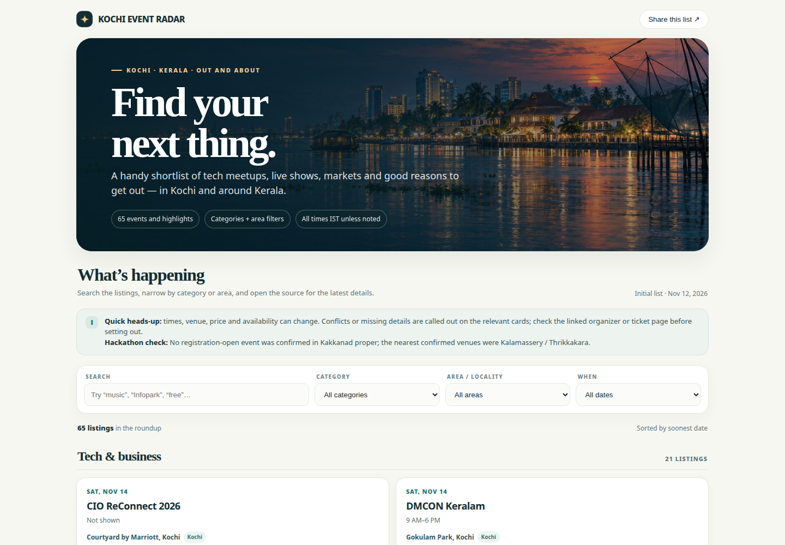

# Kochi Event Radar

A searchable, shareable guide to things to do in Kochi and around Kerala—tech meetups, live music, entertainment, markets, arts, learning, and more.

**[Open the live site](https://reogeorge.github.io/kochi-event-radar/)**



## Features

- Browse listings grouped into **Tech & business**, **Music & entertainment**, **Community, arts & learning**, and **Across Kerala & later highlights**.
- Search event titles, dates, times, venues, areas, categories, admission details, and notes.
- Filter by category, locality, and date range: all dates, the next 14 days, the next 30 days, or later.
- See event dates, times, venues, admission information, status notes, and links to organizer or ticket sources.
- Share the list using your device’s share menu, or copy the page link where browser sharing is unavailable.
- Use a responsive, lightweight site built with plain HTML, CSS, and JavaScript—no framework or build step required.

## Event data

Listings are loaded from [`events.json`](events.json). Each event includes a stable `id`, a display `title`, `category`, ISO date in `start` (`YYYY-MM-DD`), display-ready `date` and `time`, `venue`, `area`, `admission`, and optional `status` and `notes`. The `sources` array contains one or more `{ "label", "url" }` links to the relevant organizer or ticket pages.

To add or update a listing, edit `events.json` and keep it valid JSON. The page builds its category and locality filters from the event data and sorts matching listings by soonest date. Keep source links current and describe uncertain or conflicting details in the event’s notes.

Event details can change. This is an independent roundup, not an official organizer page; confirm times, locations, prices, and availability with the linked source before heading out. Times are shown in IST unless a listing says otherwise.

## Run locally

The page fetches `events.json`, so serve the repository over HTTP instead of opening `index.html` directly as a file:

```bash
python3 -m http.server 8000
```

Then visit <http://localhost:8000>.

## Deployment

The live site is published with **GitHub Pages** from this repository. The project’s only live host is GitHub Pages:

<https://reogeorge.github.io/kochi-event-radar/>
